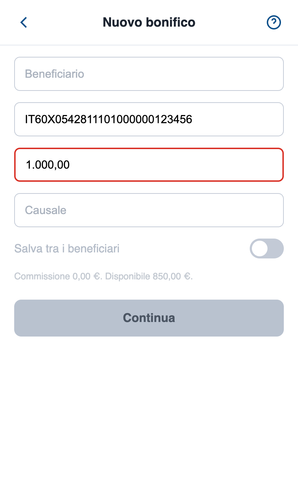
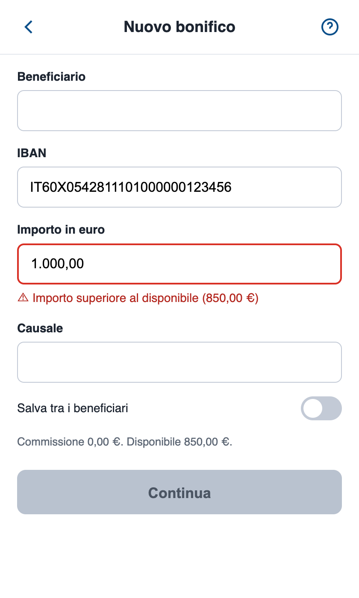

# La schermata del bonifico letta da VoiceOver

Due versioni della stessa schermata di bonifico, con la stessa grafica. Per uno screen reader sono due pagine diverse.

`prima/` è scritta come capita spesso: icone senza nome, campi con il solo placeholder, un interruttore fatto con un `div`, il pulsante "Continua" che in realtà è un `div` grigio, l'errore sull'importo segnalato solo con il bordo rosso.

`dopo/` è la stessa pagina sistemata.

Le ho misurate con axe-core e poi le ho provate con VoiceOver sul Mac.

| prima | dopo |
|---|---|
|  |  |

## Contenuto

```
prima/index.html   la pagina come capita
dopo/index.html    la pagina sistemata
stile.css          la grafica, uguale per tutte e due
misura.mjs         lancia axe-core, legge l'albero di accessibilità e prova il tasto Tab
prove/             output delle misure e screenshot
```

## Cosa serve

| | Versione |
|---|---|
| Node.js | 20 o successivo (io ho usato 22.12.0) |
| npm | quello che arriva con Node |
| Spazio su disco | circa 300 MB, quasi tutti per il Chrome che scarica Puppeteer |
| Screen reader | VoiceOver su macOS (già incluso). Su Windows NVDA, gratuito |

Ho provato tutto su macOS. Su Linux e Windows la parte con Node dovrebbe funzionare uguale, ma non l'ho eseguita.

## 1. Installa Node.js

```sh
node --version
```

Se non c'è o è più vecchio della 20:

- macOS: `brew install node`
- Ubuntu/Debian: `sudo apt install nodejs npm` (controllate che la versione sia almeno la 20)
- Windows: `winget install OpenJS.NodeJS.LTS`, poi riaprite il terminale

## 2. Installa le dipendenze

Dalla cartella di questo README:

```sh
npm install
```

Installa `axe-core` 4.13.0 e `puppeteer` 25.12.0, che scarica anche una copia di Chrome da usare in automatico.

## 3. Misura le due pagine

```sh
npm run misura
```

Per ogni pagina stampa:

- le violazioni WCAG 2.2 A/AA trovate da axe-core
- l'albero di accessibilità, cioè ruolo e nome di ogni elemento: è quello che lo screen reader ha a disposizione
- gli elementi che si raggiungono con il tasto Tab

I risultati completi finiscono in `prove/misura.json`.

## 4. Provale con VoiceOver

Aprite `prima/index.html` in Safari (con VoiceOver va meglio di Chrome).

- Accendere VoiceOver: **Cmd+F5** (o Fn+Cmd+F5), oppure Cmd più tre pressioni del tasto Touch ID
- Elemento successivo: **Ctrl+Opt+→**
- Attivare l'elemento: **Ctrl+Opt+Spazio**
- Se resta su "contenuto web": **Ctrl+Opt+Shift+↓** per entrare nella pagina
- Spegnere: di nuovo **Cmd+F5**

Poi provate anche senza VoiceOver, solo con il tasto Tab: riuscite ad arrivare a "Continua"?

Attenzione se usate Safari: di default, con Tab, Safari salta pulsanti, link e caselle e si ferma solo sui campi di testo. Io ci sono cascato: anche la pagina `dopo` sembrava fermarsi alla causale. Usate **Opt+Tab**, oppure attivate *Safari → Impostazioni → Avanzate → Premi Tab per evidenziare ogni elemento di una pagina web*, oppure fate la prova in Chrome.

Su Windows potete usare [NVDA](https://www.nvaccess.org/download/) con Firefox o Chrome: freccia giù per andare avanti, Tab per i controlli. Non l'ho provato.

## Come è andata

### axe-core

| | prima | dopo |
|---|---|---|
| Regole violate | 3 | 0 |
| Elementi coinvolti | 5 | 0 |

Sulla pagina `prima` axe-core trova:

- `button-name` (critico): il pulsante "?" non ha nome
- `color-contrast` (grave): due testi grigi troppo chiari e il pulsante "Continua" grigio
- `html-has-lang` (grave): manca la lingua della pagina

### Quello che axe-core non vede

Tre problemi, e sulla pagina `prima` sono quelli che pesano di più:

- **"Continua" non si raggiunge con Tab.** Il giro si ferma alla causale: con la tastiera il bonifico non parte. Per lo screen reader "Continua" è solo testo, non un pulsante.
- **La freccia indietro e l'interruttore "Salva tra i beneficiari" non compaiono nell'albero di accessibilità**: sono `div` con un `onclick`, senza ruolo e senza nome.
- **L'errore sull'importo è solo un bordo rosso.** Non c'è un testo da leggere, quindi chi non vede non sa che c'è un errore.

axe-core non li segnala perché, per lui, un `div` è un `div`: non può sapere che dovrebbe essere un pulsante. Per questo i controlli automatici non bastano, e la prova con la tastiera e lo screen reader va fatta a mano.

### Albero di accessibilità

Cosa ha a disposizione lo screen reader (da `prove/misura-output.txt`):

| prima | dopo |
|---|---|
| testo "Nuovo bonifico" | pulsante "Indietro" |
| pulsante **(senza nome)** | titolo "Nuovo bonifico" |
| campo "Beneficiario" | pulsante "Aiuto" |
| campo "IBAN" | campo "Beneficiario" |
| campo "Importo" | campo "IBAN" |
| campo "Causale" | campo "Importo in euro" |
| testo "Salva tra i beneficiari" | testo "Importo superiore al disponibile (850,00 €)" |
| testo "Commissione…" | campo "Causale" |
| testo "Continua" | interruttore "Salva tra i beneficiari" |
| | testo "Commissione…" |
| | pulsante "Continua" |

Con il tasto Tab: 5 elementi raggiungibili su `prima`, 8 su `dopo`.

Il testo "Commissione 0,00 €. Disponibile 850,00 €." con Tab non si raggiunge in nessuna delle due, ed è normale: Tab si ferma solo su campi e pulsanti. Il problema è che chi compila il modulo saltando da un campo all'altro non lo sente mai. Nella versione `dopo` l'ho collegato al campo Importo con `aria-describedby`, così si sente nel momento in cui serve.

### Con VoiceOver

Ho registrato lo schermo con VoiceOver acceso (voce inglese, quella del mio sistema) e ho trascritto i sottotitoli in `prove/voiceover-prima.txt` e `prove/voiceover-dopo.txt`. Nella tabella ho tolto solo "contents selected".

| | prima | dopo |
|---|---|---|
| Pulsante "?" | "button" | "Aiuto, button" |
| Campo IBAN, già compilato | "IT60X0542811101000000123456, edit text" | "IT60X0542811101000000123456, IBAN, edit text" |
| Campo Importo, in errore | "1.000,00, edit text" | "1.000,00, Importo in euro Importo superiore al disponibile (850,00 €) Commissione 0,00 €. Disponibile 850,00 €., invalid data, edit text" |
| Interruttore | mai annunciato | "Salva tra i beneficiari, off, switch" |
| Commissione e disponibile | mai letti | letti insieme all'importo |
| Continua | mai annunciato: dopo la causale sono finito sulla barra di Safari | "Continua Importo superiore al disponibile (850,00 €), dimmed, button" |

Quella che non mi aspettavo è l'IBAN. Il placeholder fa da nome solo finché il campo è vuoto: appena c'è un valore, VoiceOver legge il valore e basta. In una schermata dove i campi arrivano già compilati, l'utente sente una sequenza di numeri senza sapere a cosa si riferiscono.

E c'è un dettaglio in più: nell'albero di accessibilità di Chrome (tabella sopra) il campo della versione `prima` si chiama comunque "IBAN", preso dal placeholder. VoiceOver in Safari, a campo compilato, quel nome non lo legge. Quindi dipende dal browser, e già questo basta per non fidarsi del placeholder come etichetta.

## Cosa ho cambiato

| Problema | Correzione |
|---|---|
| Icone senza nome | `<button aria-label="Indietro">` e `aria-label="Aiuto"`, svg con `aria-hidden="true"` |
| Freccia indietro fatta con un `div` | `<button type="button">` |
| Campi con solo il placeholder | `<label for="...">` visibile per ogni campo |
| Errore solo in rosso | messaggio di testo collegato al campo con `aria-describedby`, più `aria-invalid="true"` |
| Interruttore fatto con un `div` | `<input type="checkbox" role="switch">` con la stessa grafica |
| "Continua" fatto con un `div` | `<button type="submit">` dentro un `<form>` |
| Commissione e disponibile mai letti da chi naviga per campi | collegati al campo Importo con `aria-describedby="importo-errore riepilogo"`: si sentono mentre si scrive l'importo |
| "Continua" cliccabile anche con l'importo sbagliato | `aria-disabled="true"` e `aria-describedby="importo-errore"`: VoiceOver dice "dimmed" e spiega perché |
| Lingua mancante | `<html lang="it">` |
| Testi grigi chiari | colori con contrasto sufficiente |

### Perché `aria-disabled` e non `disabled`

Con l'importo sbagliato "Continua" deve essere disattivato. Se usassi l'attributo `disabled`, il pulsante uscirebbe dal giro del Tab e VoiceOver lo salterebbe: chi non vede non saprebbe nemmeno che c'è, né perché non va avanti. Con `aria-disabled="true"` il pulsante resta raggiungibile, VoiceOver lo legge come "dimmed" e, grazie ad `aria-describedby`, dice anche il motivo. Il blocco vero lo fa il codice: se il pulsante è disattivato, il form non parte e il cursore torna sull'importo. Provato con VoiceOver: Ctrl+Opt+Spazio su "Continua" riporta sul campo Importo, che rilegge l'errore.

Nella versione `prima` il pulsante è grigio come nella `dopo`, ma è un `div` con una classe: sembra disattivato solo a chi lo vede. axe-core lo segnala come testo con poco contrasto, perché per lui non è disattivato.

L'icona ⚠ davanti all'errore è aggiunta dal CSS con `content: "⚠ " / ""`: il testo dopo la barra è il testo alternativo, vuoto, così lo screen reader non la legge.

## Problemi comuni

| Problema | Soluzione |
|---|---|
| `npm install` si blocca scaricando Chrome | Riprovate, oppure `PUPPETEER_SKIP_DOWNLOAD=1 npm install` e poi `npx puppeteer browsers install chrome` |
| In Safari, con Tab, anche la pagina `dopo` si ferma alla causale | È Safari: usate Opt+Tab o attivate "Premi Tab per evidenziare ogni elemento" nelle impostazioni avanzate |
| VoiceOver legge l'interfaccia di Safari e non la pagina | Cliccate dentro la pagina, poi Ctrl+Opt+Shift+↓ |

## Pulizia

```sh
rm -rf node_modules
npx puppeteer browsers clear
```

Attenzione: `browsers clear` cancella tutti i browser scaricati da Puppeteer in `~/.cache/puppeteer`, anche quelli usati da altri progetti.

## Link

- axe-core: https://github.com/dequelabs/axe-core
- Regole WCAG 2.2: https://www.w3.org/TR/WCAG22/
- Guida VoiceOver per Mac: https://support.apple.com/guide/voiceover/welcome/mac
