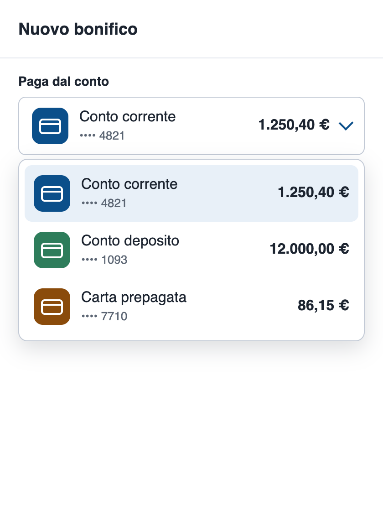
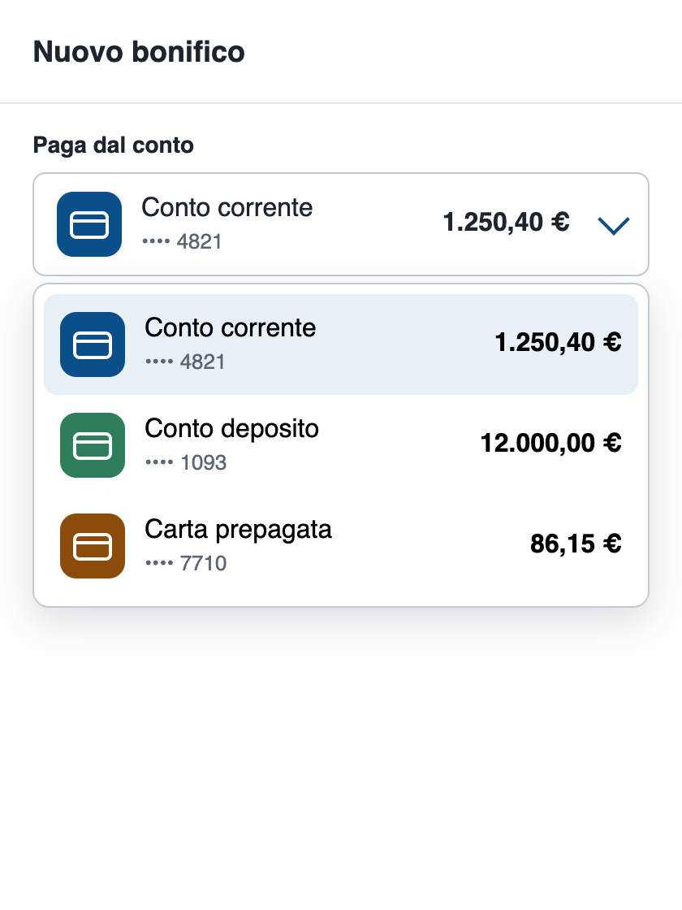
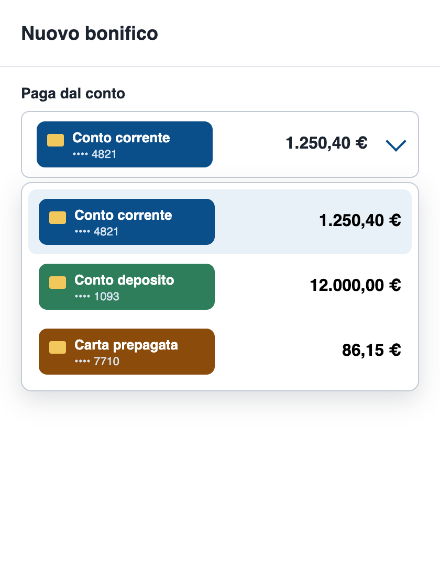

# La tendina del conto letta da VoiceOver

Una schermata "Nuovo bonifico" con una tendina per scegliere il conto da cui pagare: icona, nome del conto, ultime cifre e saldo. Tre versioni che a vederle mostrano le stesse cose:

- `fatta-a-mano/`: la tendina rifatta con dei `div`, come capita spesso quando la `<select>` del browser non basta alla grafica
- `nativa/`: una `<select>` vera, stilizzata con `appearance: base-select`
- `solo-immagini/`: la stessa `<select>` nativa, ma il nome del conto è disegnato nell'immagine della carta e nella voce non c'è testo

Fino a poco fa una `<select>` con icone e saldo in grassetto non si poteva fare: dentro le `<option>` il browser mostrava solo testo. Con `appearance: base-select` dentro le `<option>` va l'HTML che si vuole, e la `<select>` resta quella del browser. Chrome lo supporta dalla 135, Safari dalla 27 (settembre 2026).

Le ho misurate con axe-core, ho provato il tasto Tab e le ho ascoltate con VoiceOver in Safari 27.

| fatta a mano | nativa | solo immagini |
|---|---|---|
|  |  |  |

## Contenuto

```
fatta-a-mano/index.html    la tendina fatta con i div
nativa/index.html          la select con appearance: base-select
solo-immagini/index.html   la stessa select, con il nome del conto solo nell'immagine
stile.css                  lo stesso foglio di stile per tutte e tre
img/                       icone e immagini delle carte
misura.mjs                 lancia axe-core, legge l'albero di accessibilità, prova la tastiera e fa gli screenshot
prove/                     output delle misure, screenshot e trascrizioni di VoiceOver
```

## Cosa serve

| | Versione |
|---|---|
| Node.js | 20 o successivo (io ho usato 24.22.0) |
| npm | quello che arriva con Node (io 11.19.1) |
| Spazio su disco | circa 300 MB, quasi tutti per il Chrome che scarica Puppeteer |
| Browser per vedere le pagine | Safari 27 o Chrome 135 e successivi (io Safari 27.0.1 e Chrome 154) |
| Screen reader | VoiceOver su macOS (già incluso) |

Ho provato tutto su macOS 27. Su Linux e Windows la parte con Node dovrebbe funzionare uguale, ma non l'ho eseguita.

## 1. Installa Node.js

```sh
node --version
```

Se non c'è o è più vecchio della 20:

- macOS: `brew install node`
- Ubuntu/Debian: `sudo apt install nodejs npm` (controllate che la versione sia almeno la 20)
- Windows: `winget install OpenJS.NodeJS.LTS`, poi riaprite il terminale

## 2. Installa le dipendenze

Dalla cartella di questo README:

```sh
npm install
npx puppeteer browsers install chrome
```

`npm install` installa `axe-core` 4.13.0 e `puppeteer` 25.12.0. Il secondo comando scarica il Chrome che usa Puppeteer. Di solito lo fa già `npm install`, ma il mio npm (11.19.1) non lancia da solo gli script di installazione dei pacchetti e chiede di approvarli: così Chrome non arriva.

## 3. Misura le tre pagine

```sh
npm run misura
```

Per ogni pagina stampa:

- le violazioni WCAG 2.2 A/AA trovate da axe-core
- l'albero di accessibilità con la tendina chiusa e aperta, cioè ruolo e nome di ogni elemento: è quello che lo screen reader ha a disposizione
- gli elementi che si raggiungono con il tasto Tab
- se si riesce a scegliere il secondo conto solo con la tastiera (Tab fino alla tendina, Spazio, freccia giù, Invio)

I risultati completi finiscono in `prove/misura.json`, gli screenshot delle tre pagine, con la tendina chiusa e aperta, in `prove/`.

## 4. Provale con VoiceOver

Aprite le tre pagine in Safari 27.

- Accendere VoiceOver: **Cmd+F5** (o Fn+Cmd+F5)
- Se resta su "contenuto web": **Ctrl+Opt+Shift+↓** per entrare nella pagina
- Elemento successivo: **Opt+Tab** in Safari (Tab in Chrome) oppure **Ctrl+Opt+→**
- Aprire la tendina e scegliere una voce: **Ctrl+Opt+Spazio**, poi le frecce
- Spegnere: di nuovo **Cmd+F5**

Attenzione: di default Safari, con Tab, salta pulsanti e link. Usate **Opt+Tab**, oppure attivate *Safari → Impostazioni → Avanzate → Premi Tab per evidenziare ogni elemento di una pagina web*.

Se registrate lo schermo con i sottotitoli di VoiceOver, chiudete prima chat e notifiche: VoiceOver legge anche quelle, e finiscono nel video.

## Come è andata

### axe-core e tastiera

Da `prove/misura-output.txt`, Chrome 154 con Puppeteer:

| | fatta a mano | nativa | solo immagini |
|---|---|---|---|
| Regole axe-core violate | 0 | 0 | 1 (`image-alt`, 4 immagini) |
| Ruolo della tendina | nessuno, solo testo | combobox "Paga dal conto" | combobox "Paga dal conto" |
| Nome delle voci | nessuno, solo testo | "Conto corrente •••• 4821 1.250,40 €" | "1.250,40 €" |
| Raggiungibili con Tab | 2: Importo, Continua | 3: Paga dal conto, Importo, Continua | 3 |
| Secondo conto scelto solo con la tastiera | no, la tendina non si raggiunge | sì | sì |

Sulla pagina `fatta-a-mano` axe-core non trova niente. La tendina è fatta di `div` con un `onclick`, e un `div` per axe-core è un contenitore come un altro: non può sapere che dovrebbe essere un controllo. Con la tastiera, però, non ci si arriva, e il conto resta quello di partenza.

Sulla pagina `solo-immagini` axe-core trova le quattro immagini senza `alt`: le tre delle voci più la copia di quella scelta, che il browser mette nel pulsante della tendina.

### Con VoiceOver

Ho registrato lo schermo con VoiceOver acceso in Safari 27.0.1 (voce inglese, quella del mio sistema) e ho trascritto i sottotitoli in `prove/voiceover-safari-*.txt`.

| | fatta a mano | nativa | solo immagini |
|---|---|---|---|
| Tendina chiusa | mai annunciata: dal titolo si passa a "Importo in euro, edit text" | "Carta prepagata •••• 7710 86,15 €, Paga dal conto, collapsed, pop up button, group" | "86,15 €, Paga dal conto, collapsed, pop up button, group" |
| Tendina aperta | | "Carta prepagata •••• 7710 86,15 €, Paga dal conto, expanded, pop up button, group" | "86,15 €, Paga dal conto, expanded, pop up button, group" |
| Una voce del menu | | "Conto deposito •••• 1093 12.000,00 €, menu item" | "12.000,00 €, menu item" |
| Dopo la scelta | | "Conto deposito •••• 1093 12.000,00 €, Paga dal conto, collapsed, pop up button, group" | "1.250,40 €, Paga dal conto, collapsed, pop up button, group" |

La versione nativa si comporta come una `<select>` classica: dice l'etichetta, se è aperta o chiusa, e legge la voce per intero, ultime cifre e saldo compresi.

Nella versione `solo-immagini` i tre conti si distinguono solo dal saldo. Il nome del conto c'è, ma è disegnato dentro l'immagine, e per VoiceOver un'immagine senza `alt` non ha niente da leggere. Safari non legge nemmeno il nome del file.

Con Chrome ho misurato l'albero di accessibilità (tabella sopra), ma VoiceOver l'ho provato solo con Safari.

## Il codice della versione nativa

```html
<label for="conto">Paga dal conto</label>
<select id="conto" name="conto" class="conto">
  <button><selectedcontent></selectedcontent></button>
  <option value="4821" selected>
    
    <span class="nome">Conto corrente <span class="cifre">•••• 4821</span></span>
    <span class="saldo">1.250,40 €</span>
  </option>
  ...
</select>
```

```css
.conto, .conto::picker(select) { appearance: base-select; }
```

- `appearance: base-select` sulla `<select>` e su `::picker(select)` (il riquadro che si apre) attiva la nuova modalità
- `<button><selectedcontent></selectedcontent></button>` è il pulsante della tendina chiusa: il browser ci copia dentro il contenuto della voce scelta
- l'icona ha `alt=""` perché è decorativa: il nome del conto è già scritto accanto

Nella versione `solo-immagini` cambia solo il contenuto delle voci:

```html
<option value="4821" selected>
  
  <span class="saldo">1.250,40 €</span>
</option>
```

Nell'articolo in cui WebKit presenta la novità la chiamano regola d'oro: ogni `<option>` deve avere un testo, visibile o nascosto. Qui l'unico testo della voce è il saldo, e VoiceOver legge quello.

## La versione fatta a mano

È la tendina che si trova spesso. Una tendina fatta a mano può anche essere accessibile, seguendo il pattern combobox del W3C, ma vanno scritti a mano ruoli, nomi, stato aperto/chiuso, frecce, Invio, Esc e la gestione del focus. Con `base-select` tutto questo lo fa il browser.

## Cosa non ho provato

- Firefox: non ce l'ho. Nei browser che non supportano `base-select` la tendina torna una `<select>` classica con il solo testo delle `<option>`, quindi nella versione `solo-immagini` le voci mostrerebbero solo il saldo. Lo dice WebKit, io non l'ho visto.
- VoiceOver con Chrome, NVDA e JAWS su Windows.
- iPhone e Android.

## Problemi comuni

| Problema | Soluzione |
|---|---|
| `npm run misura` dice che non trova Chrome | Manca `npx puppeteer browsers install chrome` (passo 2) |
| Le tendine native sembrano `<select>` normali, senza icone | Il browser non supporta `base-select`: serve Safari 27 o Chrome 135 e successivi |
| VoiceOver legge l'interfaccia di Safari e non la pagina | Cliccate dentro la pagina, poi Ctrl+Opt+Shift+↓ |

## Pulizia

```sh
rm -rf node_modules
npx puppeteer browsers clear
```

Attenzione: `browsers clear` cancella tutti i browser scaricati da Puppeteer in `~/.cache/puppeteer`, anche quelli usati da altri progetti.

## Link

- Customizable select su WebKit, "The golden rule of Customizable Select": https://webkit.org/blog/18117/the-golden-rule-of-customizable-select/
- Customizable select su Chrome: https://developer.chrome.com/blog/a-customizable-select
- Pattern combobox del W3C: https://www.w3.org/WAI/ARIA/apg/patterns/combobox/
- axe-core: https://github.com/dequelabs/axe-core
- Guida VoiceOver per Mac: https://support.apple.com/guide/voiceover/welcome/mac
